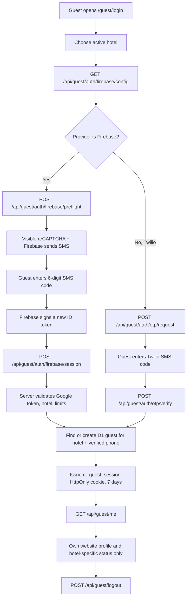

# Crystal Inn — Customer Authentication Framework
### Single-file developer handoff · Guest portal / phone login · Updated November 17, 2026

> **Start here.** This is the single, end-to-end technical handoff for the guest/customer authentication system in `fenilpatel1710/crystal-inn-website`. It describes the actual implementation, the API and database contracts, required Cloudflare/Firebase setup, security boundaries, test cases, and known unfinished work. You do **not** need to read multiple documents to understand the architecture. Linked source files are provided only when you are ready to debug or change code.
>
> **Critical distinction:** Authentication code exists on GitHub `main`. This does **not** prove Firebase is enabled or has passed an end-to-end real-SMS test on the live Cloudflare deployment. Verify the production provider and its configuration separately.

## 1. What the product does today

Crystal Inn has a **hotel-scoped, phone-number-verified website account**. There are no guest passwords. The first successful phone verification creates the website guest account if it does not already exist; subsequent verifications of the same phone at the same hotel reuse that account. Each property is deliberately isolated.

| Capability | Current implementation |
| --- | --- |
| Guest chooses a hotel before login | Implemented |
| New guest website account creation | Automatic after successful verified-phone login |
| Returning guest login | Same verified phone + selected hotel matches existing account |
| Firebase phone OTP + reCAPTCHA | Implemented in GitHub; requires provider activation and live verification |
| Previous Twilio Verify phone OTP | Still supported if server provider is `twilio` (the default) |
| Cloudflare D1 guest records | Implemented, schema migrations required |
| Website session | Secure HttpOnly cookie, seven-day expiration |
| Reuse a currently valid session | Implemented: client checks `GET /api/guest/me` |
| Guest sign-out | Implemented |
| Saved website guest contact details | Supported through authenticated stay requests |
| Verified existing Lumen guest history/rewards | **Not connected for live guest use** |
| Online government ID scanning | **Not part of portal**; verification happens at front desk |
| Automatically confirmed reservation | **Not part of auth**; stay request awaits hotel confirmation |

**Important**: Verifying possession of a phone number is not government ID verification, proof of ownership of a historic Lumen guest record, or proof that a reservation is confirmed.

## 2. Architecture at a glance



- **Client:** Next.js / React guest sign-in page, Firebase Web SDK when Firebase is selected.
- **Identity verification:** Firebase Authentication (preferred) or existing Twilio Verify (fallback).
- **Backend:** Cloudflare Workers running Next.js / OpenNext API routes.
- **Persistence:** Cloudflare D1 SQL. The website owns its own guest accounts and session records.
- **Session authority:** The backend's D1 cookie session, **not** a browser-local Firebase login state.
- **Hotel PMS:** Lumen is separate. It must not inherit website account authorization by phone alone.

## 3. Complete customer journeys

### A. First-time customer with Firebase

1. Open `https://crystalinnstay.com/guest/login`; optionally a property link can preselect the hotel using `?hotel=<hotel-slug>`.
2. Page loads published hotels from `GET /api/public/hotels` and current guest status from `GET /api/guest/me`.
3. Page reads `GET /api/guest/auth/firebase/config`. If `GUEST_AUTH_PROVIDER=firebase` and required Firebase settings exist, the Firebase form is shown.
4. Guest selects their hotel and types a **US mobile number**. Frontend normalizes it to `+1XXXXXXXXXX`.
5. Client calls `POST /api/guest/auth/firebase/preflight` with `{ "hotelId": "...", "phone": "+1..." }`. Backend checks same origin, active hotel, phone format, configured provider, D1 binding, secret pepper and per-IP/number limits.
6. Firebase Web SDK runs its visible reCAPTCHA and `signInWithPhoneNumber`. **Firebase** sends the SMS; the Crystal Inn backend does **not** send or select that code.
7. Guest enters the six-digit code. Firebase verifies it and returns an authenticated user with an **ID token**.
8. Browser sends `{ "hotelId": "...", "idToken": "..." }` to `POST /api/guest/auth/firebase/session`. Never send the raw OTP to this API.
9. Server validates Google's signed token, provider, recency, project issuer and audience; checks the selected hotel; finds or creates a website user keyed by **hotel + verified phone**.
10. Server generates a fresh random session token, stores only its SHA-256 hash in D1, and sets a `ci_guest_session` cookie.
11. Browser signs out of temporary Firebase SDK state, then reads `GET /api/guest/me` to show the guest's hotel and any **website-only** saved profile.

There is no separate password or email registration step.

### B. Returning customer

- `GET /api/guest/me` checks the HttpOnly session cookie. If valid, the guest stays signed in without paying for another SMS.
- If the cookie is absent or expired, verify the number again with the configured provider.
- Selecting another hotel creates/selects a **different hotel-scoped account**, even with the same phone. No cross-property account lookup or history merging.

### C. Twilio fallback (legacy)

If the provider is not explicitly `firebase`, the login page uses the older Twilio OTP form:
1. `POST /api/guest/auth/otp/request` starts the Twilio Verify SMS.
2. `POST /api/guest/auth/otp/verify` verifies the submitted code with Twilio.
3. Once approved, it creates/reuses the same hotel-scoped D1 user and issues the same website session cookie.

**When Firebase is enabled**, both legacy Twilio OTP routes return HTTP **410**, preventing their use as an alternate login path. Twilio may still be used for other hotel messaging; changing login providers does not migrate reservation-notification SMS.

### D. Logged-in guest profile and reservation request

- `GET /api/guest/me` returns `authenticated`, `hotelId`, `hotelName`, verified `phone`, own website `profile` (when available), and PMS link status.
- The login page links to `/book` for a guest's stay request/contact details.
- `POST /api/reservations` is currently a **Northwest 290 pilot**. If the guest has a valid session for that pilot hotel **and** the submitted phone matches the verified phone, the submitted name/email can update `portal_guest_profiles` and link the new request to that website user.
- Unauthenticated requests are permitted but are **never attached later to a guest account solely on matching phone**.
- An independently verified PMS-name snapshot may be preferred when it exists, but the reservation endpoint must never infer a Lumen identity from a phone number.
- The request is queued for hotel handling; **it is not a confirmed booking, a payment authorization, or a room assignment**.

### E. Sign-out

`POST /api/guest/logout` requires same-origin. It deletes the hashed session record where possible, and expires the `ci_guest_session` cookie. The website guest account persists in D1.

## 4. API contract cheat sheet

All addresses below are relative to the website origin.

| Method | Path | Purpose / expected behavior |
| --- | --- | --- |
| `GET` | `/api/public/hotels` | Lists active/published hotel choices |
| `GET` | `/api/guest/auth/firebase/config` | Indicates provider; returns **public Web SDK identifiers** only when Firebase is configured |
| `POST` | `/api/guest/auth/firebase/preflight` | Checks hotel, phone and request limits **before** browser asks Firebase to send SMS |
| `POST` | `/api/guest/auth/firebase/session` | Exchanges a recently verified Firebase **ID token** for a secure D1 website session |
| `POST` | `/api/guest/auth/otp/request` | Legacy Twilio send-code step; 410 when Firebase enabled |
| `POST` | `/api/guest/auth/otp/verify` | Legacy Twilio code verification; 410 when Firebase enabled |
| `GET` | `/api/guest/me` | Checks login and returns hotel-scoped website profile/status |
| `POST` | `/api/guest/logout` | Revokes session and clears cookie |
| `POST` | `/api/reservations` | Pilot stay-request creation; may save authenticated guest contact profile |

**Representative payloads (examples only — never use test token placeholders as real credentials):**

```json
POST /api/guest/auth/firebase/preflight
{"hotelId":"<active-hotel-id>","phone":"+17135550123"}

POST /api/guest/auth/firebase/session
{"hotelId":"<active-hotel-id>","idToken":"<SIGNED_FIREBASE_ID_TOKEN>"}

GET /api/guest/me
{"authenticated":true,"hotelId":"<id>","hotelName":"Crystal Inn ...",
 "phone":"+1...","profile":null,"existingPmsLinkVerified":false,
 "pmsConnected":false,"governmentIdVerification":"at_front_desk"}
```

Common statuses: `400` for malformed input, `401` for invalid/expired verification, `403` for invalid origin, `404` for inactive/unknown hotel, `410` for disabled Twilio routes, `429` for rate limits, and `503` for disabled/missing provider, D1 or other service failures. **Always inspect the actual response from the route; the table is not a formal OpenAPI specification.**

## 5. Cloudflare D1 data model

The minimum schema comes from `migrations/0009_guest_login_foundation.sql` and `migrations/0010_guest_reservation_profiles.sql`. Confirm these migrations are actually applied in the target D1 environment, not merely checked into GitHub.

| Table | What it stores | Authorization boundary |
| --- | --- | --- |
| `portal_guest_users` | Website user ID, `hotel_id`, verified `phone_e164` | Unique **(`hotel_id`, `phone_e164`)** |
| `portal_guest_sessions` | SHA-256 session token hash, user ID, hotel ID, expiry | Session token is never stored in cleartext |
| `portal_guest_login_rate_limits` | Hashed per-IP/phone request-limit keys and counts | Don't log raw identifying request details |
| `portal_guest_profiles` | Website guest's saved first/last name and email | Only linked to the authenticated website user and hotel |
| `portal_guest_reservation_links` | Links authenticated pilot stay request to portal user | Only created on correct hotel **and verified matching phone** |
| `portal_guest_lumen_links` | Pending / verified / revoked ownership mapping to PMS guest | A **separate ownership-verification process** is mandatory |

Additional verified PMS name snapshots may exist in `portal_guest_verified_pms_names`, introduced by a later migration. The guest session remains separate from the PMS staff authentication session.

**Session implementation:** `ci_guest_session` is a 32-byte random token (encoded for a cookie), stored as a SHA-256 hash in D1. Cookie flags: `HttpOnly`, `Secure`, `SameSite=Lax`, `Path=/`, `Max-Age=604800` seconds (7 days). `guestSession()` checks cookie hash, expiration, active hotel and user/hotel relationship. A verified Firebase UID is **not currently the primary D1 account key**; the verified phone is used within the selected hotel. Review risks of reassigned phone numbers before linking sensitive historic PMS data.

## 6. Server-side security rules in code

- Phone format accepts `+1` plus a valid North American number pattern (initial US pilot).
- Server enforces **same-origin checks** for sensitive POST actions; these do not replace provider-level anti-abuse controls.
- Firebase ID token: algorithm `RS256`, recognized Google Secure Token X.509 signing key, signature, `aud=FIREBASE_PROJECT_ID`, `iss=https://securetoken.google.com/<project-id>`, `firebase.sign_in_provider=phone`, verified phone, and recent `auth_time` (up to 10 minutes).
- Firebase session endpoint checks active hotel before issuing session and replaces a previous website cookie session when applicable.
- Firebase preflight rate limits: **10 requests/hour per IP** and **3 requests/hour per hotel + phone**. Session exchange limits are **30/hour per IP** and **15/hour per hotel + verified phone**.
- Twilio OTP request limits: **10/hour per IP**, **3/15 minutes per hotel + phone**. Verification limits: **30/hour per IP**, **6/15 minutes per hotel + phone**.
- Website session expiry is **7 days**; no guest document images or identity numbers are collected through the login flow.
- Website accounts and profile reads must remain hotel-scoped. Never accept an arbitrary guest ID or Lumen GuestCode as authorization.
- The preflight endpoint only limits requests made **through our website**. It does **not** guarantee a cost cap for direct Firebase API misuse. Keep Firebase reCAPTCHA, allowed domains, US SMS region restrictions, quota monitoring and Cloud Billing alerts in place.

**Before production rollout:** independently review Firebase token verification, rate-limit resilience, phone recycling/SIM-swap exposure, CSRF protections, handling of unsupported browser modes, logs, and cross-property data isolation. Build passing is not a complete security audit.

## 7. Firebase / Cloudflare setup checklist

**Registered Firebase Web project:** `crystal-inn-a9174`. The public Firebase Web SDK identifiers are in the repository's `wrangler.jsonc`. They are **not** Firebase Admin service-account secrets.

1. Firebase Console → Authentication → Sign-in method → enable **Phone**.
2. Firebase Console → Authentication → Settings → Authorized domains → confirm `crystalinnstay.com` (and any actually used `www`/approved test hostname).
3. Firebase Console → Settings → SMS region policy → allow **United States** and restrict others as appropriate.
4. Firebase project needs a suitable billing plan for sending real SMS; configure budget alerts and safe test phone numbers.
5. Cloudflare Worker `crystal-inn-website`: confirm `DB` D1 binding, `GUEST_AUTH_PEPPER` secret (32+ characters), and the `FIREBASE_PROJECT_ID`, `FIREBASE_API_KEY`, `FIREBASE_AUTH_DOMAIN`, `FIREBASE_APP_ID` variables.
6. **Switch only after validation:** set `GUEST_AUTH_PROVIDER=firebase` in the deployed Cloudflare Worker variables. When not explicitly `firebase`, the code defaults to `twilio`.
7. Disable unnecessary legacy login SMS with `GUEST_OTP_ENABLED=false` after Firebase has passed end-to-end tests.
8. Confirm that deployed configuration is active via the **live** `GET /api/guest/auth/firebase/config` response. Then complete a real/test-number OTP sign-in on the deployed domain.

**Never commit:** Firebase Admin JSON/service-account private keys, Twilio private secrets, `GUEST_AUTH_PEPPER`, authenticated cookies, real ID tokens, or hotel guest personal data. Do not confuse a public Firebase API key with an administrative credential.

## 8. Developer acceptance tests

Run these tests in an authorized non-production environment with synthetic guest accounts, then repeat a controlled live smoke test.

- [ ] `/guest/login` displays active hotels and correctly preselects one from `?hotel=slug`.
- [ ] Firebase config endpoint reports `firebase` only when the production provider variable is set.
- [ ] Valid phone → preflight succeeds → visible reCAPTCHA → SMS code → Firebase credential → signed ID token.
- [ ] Token exchange creates a fresh `ci_guest_session`; `/api/guest/me` returns `authenticated:true` and the **selected hotel**.
- [ ] A second sign-in with the same verified phone at the same hotel reuses the same website guest account.
- [ ] Same phone at a **different** hotel cannot read the first hotel's profile or reservation links.
- [ ] Missing, tampered, expired, old or wrong-project Firebase tokens are denied.
- [ ] Changing hotel ID during a request cannot expose another guest's data.
- [ ] `/api/guest/logout` invalidates the website session; `/api/guest/me` returns `authenticated:false`.
- [ ] Twilio send/verify endpoints return 410 when Firebase is the active provider.
- [ ] Too many SMS-preflight or session attempts return 429.
- [ ] Saved contact details from an authenticated **Northwest 290 pilot** reservation appear only in that website profile.
- [ ] A stay request made by an unauthenticated browser or using a mismatched phone is never silently linked to that profile.
- [ ] No historic Lumen PMS records, reward points, guest ID photos, or sensitive identity data are exposed through login.
- [ ] Firebase SMS settings, budgets/quotas and privacy notices are reviewed.
- [ ] Confirm migrations and bindings in **the deployed database/environment**, not just GitHub.

## 9. Still pending / do not assume implemented

**Authentication is implemented in source; the full connected customer portal is not.**

1. **Live Firebase provider switch and verified SMS sign-in:** production activation and real end-to-end sign-in have not been independently confirmed in this handoff.
2. **Lumen account linking:** independent ownership verification, staff approval/revocation, and a guest-safe PMS connection need separate implementation/validation. A `portal_guest_lumen_links` table alone does not provide a complete workflow.
3. **PMS history, invoices, rewards:** guest-specific secure reads/imports and access controls are not established for live guest display; `/api/guest/me` currently returns `pmsConnected:false`.
4. **Multi-property reservations:** current `POST /api/reservations` is the Northwest 290 intake pilot. Don't treat it as universal live inventory or automatic room assignment.
5. **Identity:** phone OTP does not prove legal identity or a historical Lumen record's ownership. Government ID is still a **front-desk-only** process.
6. **Provider cost controls:** website-side limits, Firebase reCAPTCHA and budgets are safeguards, not guaranteed hard SMS spend caps.

## 10. Exact implementation file map (reference — not required for first read)

| What you would change | GitHub source |
| --- | --- |
| Guest page / choose hotel / session display | [`app/guest/login/page.tsx`](app/guest/login/page.tsx) |
| Firebase SMS + reCAPTCHA Web SDK | [`components/FirebasePhoneLogin.tsx`](components/FirebasePhoneLogin.tsx) |
| Firebase public config endpoint | [`app/api/guest/auth/firebase/config/route.ts`](app/api/guest/auth/firebase/config/route.ts) |
| Firebase SMS preflight and limits | [`app/api/guest/auth/firebase/preflight/route.ts`](app/api/guest/auth/firebase/preflight/route.ts) |
| Google-signed ID token → D1 cookie session | [`app/api/guest/auth/firebase/session/route.ts`](app/api/guest/auth/firebase/session/route.ts) |
| Provider switch and token verifier | [`lib/guest/firebase.ts`](lib/guest/firebase.ts) |
| Shared cookie, rate limits, Twilio helper | [`lib/guest/auth.ts`](lib/guest/auth.ts) |
| Legacy Twilio routes | [`app/api/guest/auth/otp/request/route.ts`](app/api/guest/auth/otp/request/route.ts) and [verify](app/api/guest/auth/otp/verify/route.ts) |
| Guest session read / saved profile | [`app/api/guest/me/route.ts`](app/api/guest/me/route.ts) |
| Sign out | [`app/api/guest/logout/route.ts`](app/api/guest/logout/route.ts) |
| Reservation/profile linking pilot | [`app/api/reservations/route.ts`](app/api/reservations/route.ts) |
| Website guest D1 schema | [`migrations/0009_guest_login_foundation.sql`](migrations/0009_guest_login_foundation.sql) and [0010](migrations/0010_guest_reservation_profiles.sql) |
| Cloudflare Worker bindings and public config | [`wrangler.jsonc`](wrangler.jsonc) |

### Recommended developer handoff / next actions

1. **Read this one file** to learn the complete current system.
2. Inspect the live Firebase provider response and verify Cloudflare D1/migrations.
3. Run the guest login end-to-end acceptance tests above, with synthetic accounts.
4. Treat PMS guest linking and historical data as a **separate security-sensitive project**, not as a small extension of SMS verification.
5. Keep this document updated when the authentication provider, session contract, or guest/PMS permissions change.

*Source of truth: current implementation on the `main` branch reviewed for this document. Implementation files are authoritative if they later diverge from this guide.*
